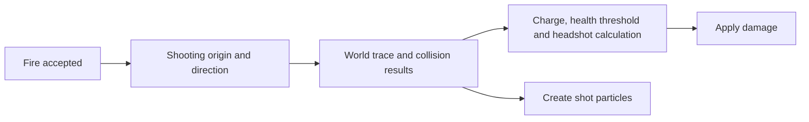

# Vindicta — Assassinate, build 6766

Research date: 9 October 2026. This report covers the installed build's ability data, client and server firing paths, scope HUD, laser particles, charge calculation, and associated modifiers. It distinguishes code-confirmed behavior from explanations that still need an observation of the specific visual effect.

## Answers to your questions

| Question | Finding | Confidence |
|---|---|---|
| Are Assassinate shots hitscan? | **Yes.** The server performs collision queries and applies damage in the same firing call. It does not spawn a bullet and wait for it to fly to the target. The shot has a configured collision radius, so “immediate traced shot” is more precise than an infinitely thin ray. | Confirmed in server code |
| What is the red aiming laser/dot? | A visualization of an aiming trace. The local player's red dot is positioned at a calculated surface intersection. A separate server-driven beam is shown to other recipients. Pointing at a person does not acquire or lock that person. | Confirmed in code and active assets |
| Why does it sway or appear behind the crosshair? | The rendered camera, aim-angle getters, animated weapon attachment and particle effects are separate paths. The public beam also has a separate server update path. These provide concrete ways for the visuals to diverge. **The exact cause of your particular observation has not been established.** | Separation confirmed; exact cause unresolved |
| What is the green circle around the center crosshair? | Assassinate's **radial charge/readiness meter**. When the ability can fire, it represents charge. When firing is unavailable, the same display uses cooldown/recharge timing. | Confirmed in HUD layout, CSS and client code |
| Does the green ring mean a target is locked or will die? | No. Its normal charge calculation uses time and ability properties, without selecting a victim or checking that victim's health. | Confirmed |
| Does bullet velocity control Assassinate travel time? | The inspected firing path uses immediate traces and does not use the generic `m_flBulletSpeed = 10000` entry to advance a projectile. | Confirmed for this firing path |

## What was inspected

The game identifies itself as client/server **6766**, Source revision **11106493**, built **8 October 2026, 15:58:12**. I analyzed the archived client and server DLLs for that build through IDA MCP and decoded relevant resources from the installed `pak01_dir.vpk` using ValveResourceFormat. The fresh schema dump helped identify class fields; executable cross-references established which fields the game actually reads.

| Input | SHA-256 |
|---|---|
| `client.dll` | `E0EDCB5F9D86F879CC9C0BA0ED37714760B81266B47ABCDBEA7F42EC233F82E0` |
| `server.dll` | `72B843001BAFDC45FA4E20547C6368F83CB9AB34DA452BBFE37AA71695173C50` |
| Compiled `scripts/abilities.vdata_c` resource | `99D39332C30086EB9D9B531791E790E7AB0C8563B764C5082AEF8386B4A4FB8F` |

No overlay behavior was changed for this investigation. The evidence is local under `verification/vindicta-6766`; extracted game assets are in the project's ignored verification directory. This report does not imply that every generic physics, damage, networking or modifier subsystem has been completely reversed.

## 1. Firing: what “hitscan” means here

The authoritative server firing routine obtains a shooting origin and direction, evaluates the ability's range, traces the path, gathers sorted collision results using a shape built from `ShotRadius`, and processes the resulting targets. It constructs damage information and calls the target damage system during that routine. There is no projectile entity, flight timer, gravity integration or distance divided by bullet speed in this path.



The server collector identifies itself in its profiling strings as `CGamePhysicsQueryInterface::TraceShapeWithSortedResults`. The ability builds the query with **ShotRadius = 4.0 engine units**. This is not a four-meter radius. The preliminary world trace bounds the subsequent hit path; an arbitrary solid wall is not bypassed merely because an enemy is beyond it.

The routine processes a list of collision results rather than stopping unconditionally after the first enemy. This supports multiple targets along a shot path. Special entity filtering and obstruction rules still come from the generic trace system. A helper in the world-trace path explicitly handles `CCitadelPortalTrigger`, which accounts for the code's optional second segment; it is not evidence of unrestricted wall penetration.

Hitscan does not mean that input, server processing, network confirmation and rendering have zero delay. Those delays are separate from projectile flight. The inspected code establishes the absence of a travel-time projectile; it does not measure your end-to-end latency or fully characterize the engine's lag compensation.

Evidence: [server firing routine](<C:/Users/varos/Desktop/dl/project/verification/vindicta-6766/mcp/server/0x1813E8980.c>), [sorted shape query](<C:/Users/varos/Desktop/dl/project/verification/vindicta-6766/mcp/server/0x181B12220.c>), [world/portal trace helper](<C:/Users/varos/Desktop/dl/project/verification/vindicta-6766/mcp/server/0x180C028A0.c>), [client firing visuals](<C:/Users/varos/Desktop/dl/project/verification/vindicta-6766/mcp/client/0x180FB77C0.c>).

### The misleading bullet-speed field

The ability resource still contains `m_mapWeaponInfos.primary.m_flBulletSpeed = 10000`. Finding that field alone would suggest a projectile speed, but the actual Assassinate firing implementation does not use it to move a bullet. Ordinary weapon bullet velocity and Assassinate's traced shot are different mechanisms.

For an accurate Assassinate model, ordinary bullet flight prediction must not be assumed just because this generic weapon-info entry exists. That is an implication of this analysis, not a change made to the overlay.

## 2. Charge and the green circle

The ability explicitly assigns the HUD context **`snipe_power`** to `element_circular_progress.vxml`. That layout places a radial progress panel in the center and requests `minimize_crosshair="true"`. Its final CSS rules specify a **70 × 70 pixel** circular panel with a **4 pixel green border, `#92CD38`**. These are nominal UI dimensions, subject to the game's HUD scaling.

This matches your clarification that the green circle is around the center crosshair. It is not the low-health highlighting effect on an enemy.

Evidence: [ability data](<C:/Users/varos/Desktop/dl/project/verification/vindicta-6766/assassinate.vdata.txt>), [HUD layout](<C:/Users/varos/Desktop/dl/project/verification/vindicta-6766/hud/assets/panorama/layout/ability_hud_elements/element_circular_progress.vxml_c.txt>), [HUD styling](<C:/Users/varos/Desktop/dl/project/verification/vindicta-6766/hud/assets/panorama/styles/ability_hud_elements/element_circular_progress.vcss_c.txt>).

### When firing is available

The client and server both calculate charge from the current game time minus the scope-start time. With this build's base values:

```text
elapsed = current_game_time - scope_start_time
charge_damage_multiplier = 0.50 + 0.50 × clamp(elapsed / 1.0 second, 0, 1)
ring_fill = (charge_damage_multiplier - 0.50) / 0.50
```

The general code includes `m_flMinScopeTimeToShoot` and evaluated ability properties. Its configured minimum scope delay is **0.0 seconds**, minimum damage is **50%**, and time to full charge is **1.0 second**. Scope-start time zero is treated as unscoped.

| Time since scope started | Ring fill in the ready-to-fire branch | Damage multiplier |
|---|---:|---:|
| Immediately | 0% | 50% |
| 0.25 s | 25% | 62.5% |
| 0.50 s | 50% | 75% |
| 0.75 s | 75% | 87.5% |
| 1.00 s or more | 100% | 100% |

Therefore, a half-filled ring corresponds to **75% damage**, not 50% damage. Waiting beyond full charge does not increase this multiplier further. In the firing routine, charge scales damage; it does not increase the configured trace radius or give the shot travel time.

The client also plays the configured fully-charged sound once when charge reaches one and the relevant readiness conditions are met. A flag prevents continuous replay of that sound. I found no automatic firing or target-lock behavior in this feedback routine.

Evidence: [charge function](<C:/Users/varos/Desktop/dl/project/verification/vindicta-6766/mcp/client/0x180F65F00.c>), [ring progress function](<C:/Users/varos/Desktop/dl/project/verification/vindicta-6766/mcp/client/0x180F62120.c>), [charged sound and local laser update](<C:/Users/varos/Desktop/dl/project/verification/vindicta-6766/mcp/client/0x180F5D130.c>).

### Why the ring can look like a reload

The ring's progress function first asks the ability's general cast-result check whether firing is currently available. A nonzero result takes a different branch. That branch reads remaining cooldown, remaining charges and, when there are no charges, remaining recharge time. It uses the larger applicable remaining delay and normalizes it against timing derived from the last cast-completed time.

In ordinary timing terms, that branch is approximately:

```text
remaining = remaining_cooldown
if remaining_charges == 0:
    remaining = max(remaining, remaining_charge_recharge)
total_interval = now + remaining - last_cast_completed_time
ring_fill = clamp(1 - remaining / total_interval, 0, 1)
```

The executable uses a clamped remapping helper, including handling for equal endpoints. This is a readiness display driven by **ability cooldown/charge state**, not the primary weapon's magazine reload counter. Other reasons an ability cannot cast also enter this branch, so the meter should not be treated as a complete explanation of every disabled state.

A full green ring does not certify line of sight, a headshot, a vulnerable enemy, or a lethal amount of damage.

## 3. The red laser, dot and fired-shot trail

Three separate visual systems matter:

| Visual | Active resource/path | What it represents |
|---|---|---|
| Local aiming dot | `hornet_assassinate_laser_sight_player.vpcf` → `..._player_dot.vpcf` | A locally updated aiming intersection |
| Public aiming beam | `hornet_assassinate_laser_sight.vpcf` | A scoped weapon beam updated through the server path for other recipients |
| Fired-shot effects | `hornet_assassinate.vpcf` and `hornet_assassinate_owner.vpcf` | Beam, impact, smoke, streak and other effects created for a fired shot |

### Local dot

While scoped, and only for the local pawn, the client creates the owner-only sight effect. Each update obtains an aiming angle and shooting origin, traces toward the evaluated range, and writes the resulting endpoint to **particle control point 1**. The dot's asset uses a `C_OP_PositionLock` at that control point and has a red base color `[255, 87, 87, 255]`.

This explains why the dot appears on a person when you aim at one: it is an intersection visualization. It can also land on world geometry. The routine does not search for the nearest enemy and attach the dot to that enemy as an aim lock.

The active owner-only parent currently references **only the dot child**. An asset named `hornet_assassinate_laser_sight_player_beam.vpcf` exists in the archive, but this parent does not instantiate it. Asset existence alone is not proof that an effect is currently used.

Evidence: [local update](<C:/Users/varos/Desktop/dl/project/verification/vindicta-6766/mcp/client/0x180F5D130.c>), [local endpoint trace](<C:/Users/varos/Desktop/dl/project/verification/vindicta-6766/mcp/client/0x180FD09D0.c>), [owner-only parent](<C:/Users/varos/Desktop/dl/project/verification/vindicta-6766/effects/assets/particles/abilities/hornet/hornet_assassinate_laser_sight_player.vpcf_c.txt>), [dot asset](<C:/Users/varos/Desktop/dl/project/verification/vindicta-6766/effects/assets/particles/abilities/hornet/hornet_assassinate_laser_sight_player_dot.vpcf_c.txt>).

### Public beam

The server separately creates the non-owner sight particle while scoped and updates its endpoint using its own aiming trace. Its recipient setup adds players and removes the owner's recipient, with additional handling for observers. The particle builds a path of points between its control points and maintains that path with `C_OP_MaintainSequentialPath`.

Consequently, watching another Vindicta's beam is not the same view as seeing your own locally generated dot. The public effect has a server/network path in addition to its particle rendering and weapon attachment.

Evidence: [server sight update](<C:/Users/varos/Desktop/dl/project/verification/vindicta-6766/mcp/server/0x1814027F0.c>), [server endpoint](<C:/Users/varos/Desktop/dl/project/verification/vindicta-6766/mcp/server/0x18141F880.c>), [public particle](<C:/Users/varos/Desktop/dl/project/verification/vindicta-6766/effects/assets/particles/abilities/hornet/hornet_assassinate_laser_sight.vpcf_c.txt>).

### Fired-shot trail

The shot effects have their own child particles, including beams, smoke, impacts, streaks, dissolve effects and embers. Their operators manage their visual lifetime and decay. The public shot visual uses the animated **`muzzle_fx`** attachment when available, with a shooting-origin fallback. The owner visual uses a different start position.

A visible streak or fading beam after firing therefore does not represent a bullet still in flight. The damage query and the visual trail are separate operations.

## 4. What can make the laser appear behind your aim?

The code establishes several distinctions that matter:

1. **Camera and aiming direction are not interchangeable.** The local sight requests an angle getter that considers locked eye angles and ability/modifier angle overrides. The firing direction uses another getter. They share a fallback but are not identical paths in every state.
2. **Weapon visuals have an attachment origin.** A beam starting from an animated muzzle is spatially different from the rendered camera and its centered crosshair. The difference is particularly noticeable near surfaces or during weapon/body animation.
3. **The public sight is updated by the server.** Its visual timing can differ from a locally rendered camera. Network/render interpolation is a possible contributor when watching that effect, but no fixed delay was measured here.
4. **A post-shot trail can outlive the shot calculation.** Moving the camera after firing can leave a visible trail at the old shot path even though the hit was already resolved.

I did **not** find a previous-endpoint lerp in the inspected local sight endpoint function, or an explicit positional smoothing setting in the active dot configuration. This does not exclude interpolation elsewhere in the renderer or particle engine. It also does not establish that every effect you describe is the same red dot.

The supported conclusion is that visual misalignment is not proof of projectile flight or an enemy lock. Identifying the exact source of your observed sway requires seeing whether it is the local dot, a public weapon beam, or a lingering fired-shot trail. I have not attributed it to the overlay, Makcu, a driver, or a specific number of delayed frames without evidence.

Evidence: [sight angle getter](<C:/Users/varos/Desktop/dl/project/verification/vindicta-6766/mcp/client/0x180869ED0.c>), [shot direction getter](<C:/Users/varos/Desktop/dl/project/verification/vindicta-6766/mcp/client/0x180869830.c>), [shooting-origin helper](<C:/Users/varos/Desktop/dl/project/verification/vindicta-6766/mcp/client/0x180869FC0.c>).

## 5. Damage formula and examples

The server checks the victim's current health percentage **before applying this shot**. The low-health condition is a strict comparison: the percentage must be **below 50**, not equal to 50. The inspected health getter reads current health; it does not add a barrier pool to that comparison.

Using evaluated ability properties, the firing routine calculates:

```text
low_health_bonus = LowHealthEnemyDamageBonus if health_percent < threshold else 0
raw_damage = (Damage + low_health_bonus) × charge_damage_multiplier
if the collision belongs to a headshot-qualified hit group:
    raw_damage *= 1 + HeadshotBonus / 100
```

The current base data provides:

```text
Damage = 90 + 0.93 × Spirit Power
LowHealthEnemyDamageBonus = 90 + 2.30 × Spirit Power
HeadshotBonus = 20%
```

Thus, against a target below the health threshold, the combined nominal full-charge body damage is **180 + 3.23 × Spirit Power**, before the second upgrade and other modifiers. Charging scales both damage components, and the headshot bonus is applied after that scaling. The code recognizes hit groups 1 and 19 for this headshot branch; this report does not assign an unverified descriptive name to group 19.

Examples with **zero Spirit Power**, no damage amplification and no mitigation:

| Target state | Immediate body shot | Full-charge body shot | Full-charge headshot |
|---|---:|---:|---:|
| At or above 50% health | 45 | 90 | 108 |
| Below 50% health | 90 | 180 | 216 |
| Below 50%, second upgrade obtained | 130 | 260 | 312 |

These are raw nominal values, not promises about the health number lost in a match. The ability passes the result into the normal damage system, where barriers, resistance, amplification, immunity and other mechanics can matter. I did not reverse every downstream modifier in that system.

There is no distance-based damage multiplier in the inspected Assassinate-specific formula. That finding is limited to this formula; it is not a claim that every downstream game rule has been excluded.

Evidence: [server calculation and damage application](<C:/Users/varos/Desktop/dl/project/verification/vindicta-6766/mcp/server/0x1813E8980.c>), [property bindings](<C:/Users/varos/Desktop/dl/project/verification/vindicta-6766/mcp/server/0x18135BFE0.c>), [ability values](<C:/Users/varos/Desktop/dl/project/verification/vindicta-6766/assassinate.vdata.txt>).

## 6. Other mechanics found

| Setting/mechanic | Base value or verified behavior |
|---|---|
| Charges | 2, subject to the ability-charge scaling system |
| Recharge/cooldown property | 55 seconds, subject to cooldown modifiers |
| Delay between charges | 2.5 seconds, using the ability recharge-time scaling system |
| Range property | 1000 m in the resource |
| Minimum scope time to shoot | 0.0 seconds |
| Charge duration | 1.0 second to full damage |
| Minimum charge damage | 50% |
| Scoped movement | A movement override reads the `MoveSpeed = 4m` property while scoped |
| Scope FOV data | One entry, 30; the camera applies it through its FOV operations |
| FOV transition | 0.15 seconds |
| View punch | 2.5 configured and read by the firing path |
| First upgrade | Cooldown −15 seconds before further scaling |
| Second upgrade | Low-health bonus +80 raw base damage |
| Third upgrade | Weapon-damage bonus per credited stack +4 percentage points |

The configured scope FOV is not a reason to hardcode the overlay projection to 30. The camera applies FOV operations, and the final rendered projection is also affected by the game's camera/aspect configuration. This is consistent with using the completed render matrix for the overlay.

### Low-health glow

The ability has a separate `modifier_low_health_glow` with `status_fx_hornet_snipe.vpcf`. The server iterates relevant enemy players, compares their health fraction against the threshold, and applies or removes this modifier accordingly. This is separate from the green center ring and from the red aiming dot.

The existence of a low-health highlight does not mean the current shot is lethal: charge, actual damage properties and the target's protection still matter. I have not characterized every visibility rule governing how that glow is rendered.

Evidence: [glow update](<C:/Users/varos/Desktop/dl/project/verification/vindicta-6766/mcp/server/0x18136BE50.c>).

### Kill-related tracking and weapon damage

The server firing routine attaches the configured hidden `killcheck_modifier` to qualifying player targets for **4 seconds**. This is kill-related tracking metadata, not a four-second bullet lifetime.

The intrinsic `modifier_hornet_snipe_kill_bonus` binds `WeaponDamageBonusPerKill`. Its value callback multiplies its stack count by the evaluated bonus property. The base property is **6%**, and the third upgrade adds **4**, giving **10% per credited stack**. For example, three stacks report 18% with the base property or 30% with that upgrade.

The stack event handler checks that its event belongs to the matching ability before updating the count. I verified the property, stack handling and value calculation, but have not completely traced the generic death/credit event producer. Consequently, this report does not claim that every assist, clone, bot death or kill within four seconds necessarily grants a stack.

Evidence: [modifier constructor](<C:/Users/varos/Desktop/dl/project/verification/vindicta-6766/mcp/server/0x18130F7E0.c>), [event registration](<C:/Users/varos/Desktop/dl/project/verification/vindicta-6766/mcp/server/0x18130E810.c>), [stack event](<C:/Users/varos/Desktop/dl/project/verification/vindicta-6766/mcp/server/0x1813E1F70.c>), [bonus value](<C:/Users/varos/Desktop/dl/project/verification/vindicta-6766/mcp/server/0x1813845D0.c>).

### Scope entry and exit

Selecting Assassinate establishes the scope-start time and starts the camera/FOV operation. The unscoping path clears scope-start time, restores camera state, removes the scope modifier and stops associated particle handles. Ability selection and interrupt conditions can also trigger exit. The resource lists stunned as an interrupting state, and the server has additional state checks.

The displayed scope state is therefore a concrete ability state, rather than a guess based only on zoom level. The schema exposes `CCitadel_Ability_Hornet_Snipe.m_flScopeStartTime` at client **+0x1FE4** and server **+0x1DAC** for these binaries.

Evidence: [scope entry](<C:/Users/varos/Desktop/dl/project/verification/vindicta-6766/mcp/client/0x180FB4F90.c>), [zoom operation](<C:/Users/varos/Desktop/dl/project/verification/vindicta-6766/mcp/client/0x180F58880.c>), [scope exit](<C:/Users/varos/Desktop/dl/project/verification/vindicta-6766/mcp/client/0x180FD11D0.c>).

## 7. Stale data that should not be mistaken for current mechanics

The resource includes fields whose presence alone is misleading:

- **`m_flScopeMinPowerFrac = 0.25`**: the current charge function uses the bound `MinChargeDamagePercent` property, whose value is 50. The current formula is not a 25% minimum simply because this older-looking field remains in the resource.
- **`m_flScopeTimeToFullPower`**: the current charge path reads the bound `TimeToFullCharge` property. Both happen to say one second here, but the property read is the relevant implementation evidence.
- **`BonusGoldOnKill = 250`**: this entry remains in the ability data, but the inspected Assassinate and kill-bonus constructors do not bind it. The server string's code reference is in `CCitadel_Modifier_Nano_Bounty`, another modifier. I found no Assassinate payout implementation using this entry, so I would not claim an additional 250 souls per kill from it.
- **Generic bullet speed 10000**: it does not establish projectile travel for the traced firing path.
- **Unused-looking particle assets**: an archive can contain variants that are not instantiated by the active parent. The owner-only laser-beam asset is an example.

Evidence: [current server property bindings](<C:/Users/varos/Desktop/dl/project/verification/vindicta-6766/mcp/server/0x18135BFE0.c>), [current client charge function](<C:/Users/varos/Desktop/dl/project/verification/vindicta-6766/mcp/client/0x180F65F00.c>), [other modifier's gold binding](<C:/Users/varos/Desktop/dl/project/verification/vindicta-6766/mcp/server/0x1814453A0.c>).

## 8. Reversing reference and remaining limits

These are **IDA virtual addresses for the analyzed files at image base `0x180000000`**, not stable addresses for later patches and not live process addresses with ASLR applied. Descriptive labels below are analysis labels, not recovered original function names.

| Role | Module | IDA address |
|---|---|---|
| Ability property bindings | client | `0x180F44B40` |
| Charge multiplier | client | `0x180F65F00` |
| Green-ring progress | client | `0x180F62120` |
| Green-ring active condition | client | `0x180FCEF20` |
| Local laser and charged sound | client | `0x180F5D130` |
| Local laser endpoint | client | `0x180FD09D0` |
| Client firing effects | client | `0x180FB77C0` |
| Scope entry | client | `0x180FB4F90` |
| Scope/FOV operation | client | `0x180F58880` |
| Scope exit | client | `0x180FD11D0` |
| Ability property bindings | server | `0x18135BFE0` |
| Authoritative firing and damage | server | `0x1813E8980` |
| Sorted collision query | server | `0x181B12220` |
| Public laser update | server | `0x1814027F0` |
| Public laser endpoint | server | `0x18141F880` |
| Low-health glow management | server | `0x18136BE50` |
| Kill-bonus stack event | server | `0x1813E1F70` |
| Kill-bonus value | server | `0x1813845D0` |

The evidence folder includes addressed pseudocode and raw MCP responses, asset manifests and a vtable catalog. Float signatures were corrected in the research IDBs where SSE arguments/returns and the inspected implementations supported them; the DLL bytes were not patched. Pseudocode variable names and unannotated generic call signatures can still be imperfect, so conclusions were checked against call sites and assembly where necessary.

One unresolved technical detail is that the fallback aim-angle helper reads an angle at a private location that is not the schema-exported `m_angEyeAngles` offset. This report treats it as the helper's fallback angle rather than falsely assigning that public field name to it.

The remaining limits are the exact cause of your observed laser sway, complete generic kill-credit eligibility, every downstream damage modifier, and the engine's full interpolation/lag-compensation behavior. The main findings—immediate traced shots, damage charging, the green radial display's two timing roles, and separate laser/shot visual paths—are supported directly by the current executable and resources.
